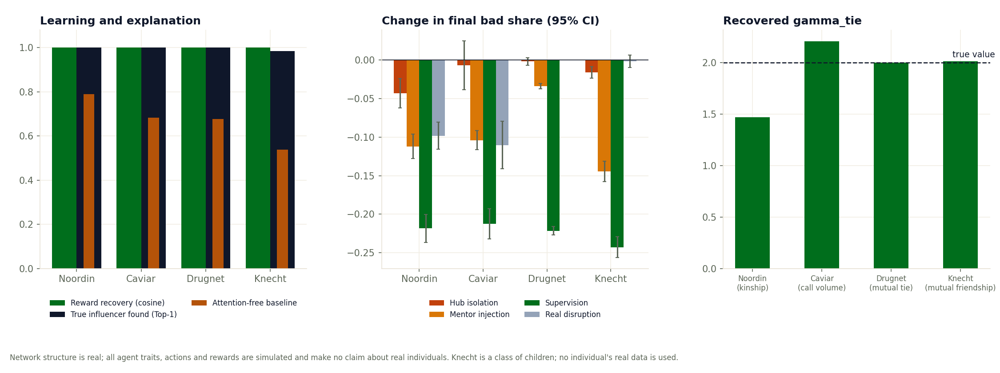

# Four networks, one model: comparison

_Network structure is real; all agent traits, actions and rewards are simulated and make no claim about real individuals. Knecht is a class of children; no individual's real data is used._

Same answer key, actions, beta and seed on every network; only the network underneath changes.

## Table

| dataset | nodes | ties | groups(>=2) | isolates | max_degree | hub_share | tie_feature | cosine(theta) | gamma_status_hat | gamma_tie_hat | top1_influencer_acc | top3_influencer_acc | spearman_ablation | cascade_gap_recovered | cascade_gap_bc | strongest_intervention | hub_isolation_effect |
|---|---|---|---|---|---|---|---|---|---|---|---|---|---|---|---|---|---|
| noordin | 28 | 38 | 3 | 0 | 10 | 0.263 | Kinship | 1.000 | 4.050 | 1.469 | 1.000 | 1.000 | 0.741 | 0.002 | 0.015 | Supervision +0.2 (-0.218) | -0.043 |
| caviar | 110 | 205 | 1 | 0 | 60 | 0.293 | Call volume | 1.000 | 4.006 | 2.207 | 0.999 | 1.000 | 0.649 | 0.003 | 0.018 | Supervision +0.2 (-0.213) | -0.007 |
| drugnet | 212 | 284 | 9 | 0 | 15 | 0.053 | Mutual tie | 1.000 | 4.007 | 2.001 | 1.000 | 1.000 | 0.375 | 0.001 | 0.006 | Supervision +0.2 (-0.221) | -0.002 |
| knecht | 26 | 63 | 1 | 0 | 10 | 0.159 | Mutual friendship | 1.000 | 3.977 | 2.010 | 0.984 | 1.000 | 0.434 | 0.004 | 0.012 | Supervision +0.2 (-0.243) | -0.016 |

## What happened

1. **Recovery and explanation stay high on all 4 networks, as hypothesised.** Cosine to the true reward ranges from 0.9999 to 1.0000, and the recovered attention names the true influencer in 98.4% to 100.0% of held-out decisions, against 54% to 79% for the attention-free baseline.
2. **The strongest intervention did not change between networks, contrary to the hypothesis.** Supervision +0.2 gave the largest drop on every network (Noordin -0.218, Caviar -0.213, Drugnet -0.221, Knecht -0.243). In this model the incentive change acts on every agent directly, while network edits only act through who copies whom, so the network shape decides how much the structural interventions help, not which one wins.
3. **Hub isolation, from largest to smallest drop:** Noordin -0.043, Knecht -0.016, Caviar -0.007 (interval includes zero), Drugnet -0.002 (interval includes zero). Caviar ranks 3 of 4, not first as hypothesised, even though its hub touches 29% of all ties; Knecht ranks 2 of 4, not last as hypothesised. The hub's share of ties does not predict the size of the effect here; why is not tested by this run.
4. **The tie feature is identified much better off Noordin.** True gamma_tie is 2; recovered: Noordin 1.47, Caviar 2.21, Drugnet 2.00, Knecht 2.01. Share of ties carrying a 0/1 tie feature: Noordin 89%, Drugnet 19%, Knecht 44%. When nearly all ties carry it, as on Noordin, the data rarely contrasts ties with and without the feature; a continuous feature such as Caviar's call volume, or a split nearer the middle, gives the learner that contrast.
5. **The real later networks:** Noordin -0.098 [-0.116, -0.080]; Caviar -0.110 [-0.141, -0.079]; Knecht -0.001 [-0.009, +0.007]. Drugnet has no later network.
6. **Acceptance criteria (SPEC.md section 11):** every criterion passes on every network.

The hypothesis in SPEC_MULTIDATASET.md was: recovery and explanation stay high everywhere, the strongest intervention changes, hub isolation matters most on Caviar and least on Knecht. The points above say which parts held.

Drugnet's isolates column counts agents in the file; the 81 people without ties on the dataset card are not in the file, so the model runs on the 212 connected people.

